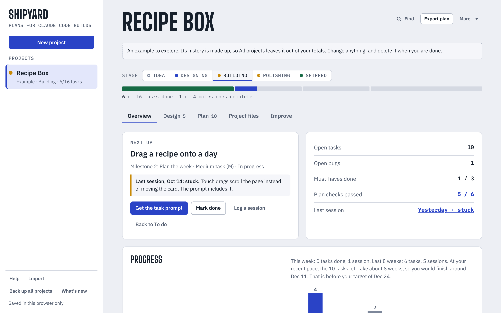

# Shipyard Planner

Plan, design and improve the projects you build with [Claude Code](https://code.claude.com).

Shipyard is where you plan a project, and Claude Code is where it gets built. You describe the idea, break it into small tasks, and Shipyard writes the files and prompts Claude Code works from (CLAUDE.md, PLAN.md, a `/next` command, settings). After each Claude Code session you log what happened, and Shipyard marks the task done, suggests what is next, and turns anything that went wrong into a rule for CLAUDE.md.



It is a single web page with no server, no build step to use it, and no account of its own. Your projects stay in your browser.

## Use it

Pick whichever is easiest:

- **Open the file.** Download [`index.html`](index.html) (or clone this repository) and open it in your browser.
- **Run it locally.** With Node.js 18 or later: `npm start`, then open <http://localhost:8080>.
- **Host it.** `index.html` is the whole app, so any static host works. On GitHub Pages: fork this repository, then in **Settings → Pages** choose **Deploy from a branch**, branch `main`, folder `/ (root)`. The app appears at `https://<your-user>.github.io/Claude.md-planner-/`.

New to it? [docs/how-to.md](docs/how-to.md) walks through a first project and an everyday session. The same guide is inside the app: choose **Help**, or press **?**.

### Where your projects are kept

Opened from a file or a normal website, Shipyard saves to your browser's local storage. Clearing the browser's data for the page removes your projects, so use **Back up all projects** now and then; **Import** brings a backup back, also on another computer or browser.

Shipyard was first built as a [claude.ai](https://claude.ai) artifact. Published there, it also saves projects to your Claude account and turns on the features that ask Claude for help (filling in a plan from an idea, splitting tasks, reviewing a project, answering questions). Those buttons are hidden when the page runs anywhere else, and everything else works the same. See [Publishing on claude.ai](docs/developing.md#publishing-on-claudeai).

## Develop

```sh
git clone https://github.com/hunterawsome1243/Claude.md-planner-.git
cd Claude.md-planner-
npm install                          # Playwright, for the browser tests
npx playwright install chromium      # once, the browser the tests drive
npm test                             # build, then run every test
```

| Command | What it does |
| --- | --- |
| `npm run build` | Puts `src/app.js` into `src/shell.html` and writes `index.html` and `dist/shipyard.html` |
| `npm start` | Builds, then serves the folder at <http://localhost:8080> |
| `npm test` | Builds, then runs all tests (about 150 files, a few minutes) |
| `npm run test:unit` | Only the fast checks that need no browser |
| `node test/run.js r52 keyboard` | Only the test files whose path contains one of these words |

The code is plain JavaScript with no framework and no dependencies:

- `src/app.js` is the app: state, storage, rendering and every screen.
- `src/shell.html` is the page around it: the styles and the static markup.
- `index.html` is built from those two. Edit `src/`, run `npm run build`, and commit `index.html` with your change (CI checks that it matches).

[docs/developing.md](docs/developing.md) explains how the app is put together, how the tests work, and how to publish it on claude.ai.

## Contributing

Issues and pull requests are welcome. Keep `npm test` passing, add a test for what you change (see [Writing a test](docs/developing.md#writing-a-test)), and commit the rebuilt `index.html`.

## License

[MIT](LICENSE)
